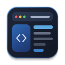

# Cinnamon Desklet Template

<p align="center">
  
</p>

<p align="center">
  <strong>A clean, modular, and ready-to-use template for developing Linux Mint Cinnamon desktop desklets.</strong>
</p>

<p align="center">
  <a href="#features">Features</a> •
  <a href="#installation">Installation</a> •
  <a href="#project-structure">Project Structure</a> •
  <a href="#how-to-customize">How to Customize</a> •
  <a href="#license">License</a>
</p>

---

## Features

- **Pre-configured Cinnamon Settings**:
  - **Appearance**: Language selection, Compact mode toggle, Custom desklet title.
  - **Size**: Configurable width, height, font size, and UI scale (75% - 200%).
  - **Colors**: Full color pickers for background, text, accent, and borders.
  - **Frame & Transparency**: Opacity slider, border thickness, and corner radius.
- **Sectioned Settings Schema**: Uses Cinnamon's native `layout` engine with clean, boxed setting groups on a single page.
- **Reactive UI & Theming**: Live hot-reloading of visual styles whenever settings change in the Cinnamon Configure menu.
- **Auto-Installation Script (`install.sh`)**:
  - One-command installation to `~/.local/share/cinnamon/desklets/`.
  - Automatic Cinnamon desklet reload via DBus (`ReloadXlet`).
  - Cache clearing to ensure schema and UI updates apply instantly.
- **Safe Lifecycle Management**: Clean cleanup for timers, settings bindings, and UI state on desklet removal.

---

## Project Structure

```text
desklet-template/
├── desklet-template@egemngyk/
│   ├── desklet.js              # Core desklet logic, UI skeleton, and settings bindings
│   ├── settings-schema.json    # Cinnamon configuration schema & boxed layout
│   ├── metadata.json           # Desklet metadata, UUID, name, and version
│   ├── stylesheet.css          # Custom styling and CSS classes
│   └── icon.png                # Desklet icon (128x128)
├── install.sh                  # Installer & uninstaller helper script
├── LICENSE                     # MIT License
└── README.md                   # Documentation
```

---

## Installation

### Quick Install / Update

Clone this repository and run the install script:

```bash
git clone https://github.com/egemngyk/cinnamon-desklet-template.git
cd cinnamon-desklet-template
chmod +x install.sh
./install.sh
```

Then add the desklet to your desktop:

1. Right-click your Cinnamon panel or desktop and select **Desklets** (Masaüstü Araçları).
2. Find **Cinnamon Desklet** in the list and click **+** (Add to desktop).
3. Right-click the desklet on your desktop and select **Configure** to test the settings menu.

### Uninstall

```bash
./install.sh --uninstall
```

---

## How to Customize

### 1. Change the UUID and Name

- Rename the folder `desklet-template@egemngyk` to your desired UUID: `<desklet-name>@<author>`.
- Update `UUID` in `install.sh`.
- Edit `metadata.json` with your project's name, description, author website, and version.

### 2. Build Your UI

Open `desklet-template@egemngyk/desklet.js` and edit the `_render()` method:

```javascript
_render: function () {
    // Clear old children
    this._root.get_children().forEach(c => this._root.remove_actor(c));

    // Add your custom St (Clutter) actors here:
    const myLabel = new St.Label({ text: "My Awesome Desklet" });
    this._root.add_actor(myLabel);
}
```

### 3. Add Custom Settings

Add new configuration keys to `desklet-template@egemngyk/settings-schema.json` and declare them in `CFG_KEYS` in `desklet.js`.

---

## License

This project is licensed under the [MIT License](LICENSE).
